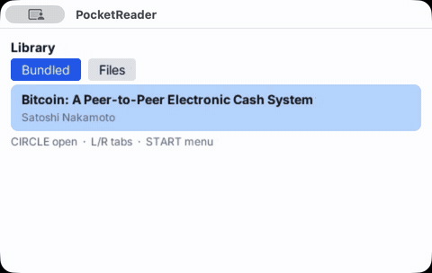

# pocketjs-react

React on [PocketJS](https://github.com/pocket-nexus/pocketjs): a UI framework base for screens driven by a d-pad and a few buttons.

> Early exploration. Unofficial: not affiliated with or endorsed by Pocket Nexus.



[Full-quality video](./docs/demo.mp4)

The demo above shows an English and a simplified Chinese book in the macOS app.

## What exists

- **Renderer** — real `react` (19.3.1) through a custom `react-reconciler` (0.34.0) renderer that writes PocketJS's native View/Text/Image tree. No DOM, no CSS engine, no WebView.
- **Tailwind + clsx + cn** — `className` takes any string React code builds: literals, ternaries, `clsx(...)`, `cn(...)` (clsx + tailwind-merge). Each class combination becomes a native style record, so `focus:`, `active:` and transitions stay native.
- **Inline styles** — the standard React `style` prop with camelCase CSS names, mapped to the core's properties.
- **D-pad input** — `FocusScope` (traps focus, restores it on close) and `useButton` (face and shoulder buttons, innermost handler wins), built on PocketJS's own focus manager. Confirm = CIRCLE, back = CROSS.
- **Components** — `List` (d-pad-operable rows, optionally a scrolling window), `Dialog` (portaled overlay that traps focus and closes on back), `Grid` (row/column d-pad movement), `Tabs` (shoulder buttons switch, focus remembered per tab) and `Menu`.
- **Mouse as a second layer** — a click focuses and presses what it points at, through the same focus system (an open dialog keeps clicks behind it inert).
- **Per-frame hook** — `useFrame(cb)` runs once per host frame with a 0-based counter (the React counterpart of the framework's frame pump), for games and animations.
- **E-book reader example** — `examples/reader`: an EPUB reader with the Bitcoin whitepaper bundled, which also reads Chinese EPUBs on both hosts (see below).
- **ASCII animation example** — `examples/ascii-anim`: a 40×18 monospace plasma (`text-xs font-mono`) redrawn every frame; CROSS pauses and restarts. Measured by `bun run measure:web --app=ascii-anim`.
- **macOS app** — `bun run build:app` packages the reader and the desktop host as a double-clickable, ad-hoc-signed `PocketReader.app` that opens an EPUB from disk (see below).
- **Build** — `tools/build.ts` turns TSX and Tailwind class strings into one guest bundle and a `.pak` (styles + baked font atlases), using PocketJS's own compiler.
- **Two hosts** — the browser WASM host and the macOS desktop host. Both run the same example with measured numbers (below).

Not here yet: handhelds and phones, touch input, toggles, geometric spatial navigation (the core has no node-rect query), and full Tailwind (see the inventory).

## Quick start

```sh
bun install
bun run typecheck
bun test                                          # every suite runs on the real PocketJS wasm core
bun run build examples/list-dialog/main.tsx       # dist/list-dialog.js + dist/list-dialog.pak
bun run measure:web                               # example in the browser host (headless Chrome)
POCKETJS_ROOT=../pocketjs bun run measure:desktop # example on the macOS desktop host
POCKETJS_ROOT=../pocketjs bun run measure:desktop-shot
```

The desktop host is not part of the npm package. Clone [PocketJS](https://github.com/pocket-nexus/pocketjs) next to this repo at the version pinned in `package.json`, run `bun install && bun run macos hero --build-only` there once, and point `POCKETJS_ROOT` at it. The measure scripts refuse a checkout whose version differs from the pinned package.

```tsx
import { useState } from "react";
import { clsx } from "clsx";
import { cn, Dialog, List, mount, Text, View } from "pocketjs-react";

function App() {
  const [on, setOn] = useState(false);
  return (
    <View className="w-full h-full flex-col p-4 bg-slate-900">
      <View className={cn("px-3 py-1 rounded-lg bg-slate-800 focus:bg-blue-600", on && "px-6 bg-emerald-700")}
            focusable onPress={() => setOn((v) => !v)}>
        <Text className={clsx("text-sm text-white", { "font-bold": on })}>Toggle</Text>
      </View>
      <View className="w-[120px] h-[10px] bg-slate-700">
        <View style={{ width: on ? 120 : 20, height: 10, backgroundColor: "#22c55e" }} />
      </View>
    </View>
  );
}

mount(<App />);
```

`View`, `Text` and `Image` are the host elements. React's DOM typings already claim lowercase `view`/`text`/`image` for SVG, so they are exported as components. At runtime each one is the host type string, with no wrapper.

## E-book reader

```sh
bun run build:reader      # dist/reader.js + dist/reader.pak, with the whitepaper EPUB bundled
bun run serve:reader      # browser host page: http://127.0.0.1:8140/ (file picker, saved state, mouse)
bun tools/web/shots.ts    # screenshots of library, contents and two reading pages in headless Chrome
POCKETJS_ROOT=../pocketjs bun run measure:desktop -- --app reader
```

- **Screens** — library (Bundled / Files tabs), contents, reading view, and a START menu with settings (font size S/M/L, light/dark).
- **Controls** — the d-pad moves focus, CIRCLE confirms, CROSS goes back. In the reading view LEFT/RIGHT turn pages, UP/DOWN scroll three lines and L/R switch chapters. A mouse click presses what it points at; clicking the left or right half of a page turns it.
- **Keys** — desktop: arrows, X = CIRCLE, Z = CROSS, Q/W = L/R, Space = START. Browser host page: arrows, Enter/Z = CIRCLE, X = CROSS, Q/E = L/R, Space = START.
- **Formats** — EPUB (2 and 3, reflowable). Chapters are read lazily: opening a book inflates only its package files. Images in books are shown as their caption or alt text. PDF, TXT and Markdown are not supported yet.
- **Where books come from**:
  - Bundled: `tools/build.ts --asset name=file.epub` embeds a book in the app.
  - Files (browser host page): EPUBs picked with the page's file input appear under `books/`.
  - The desktop host mounts no file system for apps. It shows bundled books, plus the one book the macOS app's launcher hands it at launch (see below).
- **Saved state** — font size, theme and the reading position per book are saved where the host offers a writable file system (the browser host page, backed by localStorage), and the app reopens on the saved page. On the desktop host they last for the session.
- **Characters** — book text arrives at runtime, so the build bakes ASCII, Latin-1, General Punctuation and every character of the bundled book (`--glyphs`). Chinese, Japanese and Korean text is covered per host (next section).
- **Bundled book** — *Bitcoin: A Peer-to-Peer Electronic Cash System* (Satoshi Nakamoto, 2008), an EPUB 3 edition built in this repo from the PDF distributed by bitcoin.org under the MIT licence. Figures are described by captions. Source, hashes and licence: [assets/books/NOTICE.md](./assets/books/NOTICE.md).

Measured with the minified reader, 3 runs per host, on the same machine as below:

| Host | Command | First render | Page turn (median / max) | Chapter switch | Opening a chapter |
|---|---|---|---|---|---|
| Browser WASM host | `bun run measure:web -- --app reader` | 20.8–21.4 ms | 0.7–1.1 / ≤2.7 ms | 1.7–2.3 ms | 2.1–5.8 ms |
| macOS desktop host (QuickJS) | `POCKETJS_ROOT=../pocketjs bun run measure:desktop -- --app reader` | 30.6–31.4 ms | 4.2–4.4 / ≤10.0 ms | 9.8–10.3 ms | 12.9–17.6 ms |

Reader bundle 302,067 bytes minified (110,981 gzip); pak 907,760 bytes (eight font slots with Latin-1 and punctuation).

### Chinese text

Each host draws CJK text its own way, picked by measurement (no PocketJS change):

| Host | How | Coverage | Cost |
|---|---|---|---|
| Browser host page | The page runs the app through the npm package's `hosts/web/app-instance.js` with `text.glyphs.runtime`: a character no atlas has is drawn with the browser's fonts the first time it is measured. | Any script the browser has a font for. | No pak growth. A cold first chapter of ~1,000 new characters takes one 250–500 ms frame; the next chapter's characters are warmed while reading (≤50 per frame), so a chapter switch is ~30 ms. |
| macOS desktop host | `bun run build:reader -- --cjk` bakes a fixed set into the body slots (S/M/L, regular weight) from a committed Noto Sans SC subset. | 8,836 hanzi (GB2312 levels 1+2 ∪ Big5 level 1: simplified and traditional) plus 215 CJK punctuation, full-width and compatibility forms. | Reader pak 0.91 MB → 9.95 MB; host start-up to ready measured the same as without it (probe). |

- **Coverage of a real novel** — *三國志演義* (traditional, 4,107 distinct hanzi): the baked set covers **99.53 %** of its hanzi occurrences (3,857 of 4,107 distinct). A simplified-only set covers 71.4 % (GB2312 1+2) or 68.8 % (GB2312 level 1), which is why the set is the union.
- **Missing characters** — where glyphs are baked, a character outside the set draws as the core's placeholder box, and the reading view's footer says `N characters cannot be shown on this host`. Chapter 1 of the novel has 10 such characters (rare names) on the desktop build. The browser page never shows the footer.
- **Text rules** — a line break in the source between two CJK characters is dropped instead of becoming a space (EPUBs often keep a source's hard wraps). No line starts with closing punctuation (`，。、；：？！」』）》〉】…`) and none ends with an opening bracket: the character moves down a line, and the rest is wrapped again, so lines still fit.
- **Weights** — Han text draws in regular weight: bold slots carry no CJK (it would double the pak), so `cjkSafe(className, text)` drops `font-bold` from Han titles and headings. Per mille signs (‰ ‱) are left out of the CJK slots, because an atlas cell is as wide as its widest glyph.
- **Not supported** — vertical text, ruby, regional glyph variants (one SC rendition), CJK weights other than regular, GBK/Big5-encoded files.
- **Fonts and test book** — Noto Sans SC (SIL OFL 1.1), subset reproducibly from a pinned upstream commit: [assets/fonts/NOTICE.md](./assets/fonts/NOTICE.md). The Chinese test book is chapters 1–3 of Project Gutenberg #23950, public domain in the US: [test/fixtures/books/NOTICE.md](./test/fixtures/books/NOTICE.md).

```sh
bun run build:reader -- --cjk                    # desktop build with the CJK set baked
bun tools/web/shots.ts --book test/fixtures/books/sanguo.epub   # Chinese book picked on the browser page
bun run measure:web -- --app reader-cjk          # both hosts, with the Chinese book bundled
POCKETJS_ROOT=../pocketjs bun run measure:desktop -- --app reader-cjk
```

| Host (`--app reader-cjk`, 3 runs) | First render | Opening chapter 1 | Page turn (median) | Chapter switch |
|---|---|---|---|---|
| Browser host page (runtime glyphs) | 38.4–39.1 ms | 254–269 ms (cold glyphs) | 0.7–0.8 ms | 3.5–9.4 ms |
| macOS desktop host (baked set) | 46.3–46.8 ms | 30.6–33.1 ms | 2.0–2.6 ms | 30.2–38.0 ms |

## macOS app (desktop host)

```sh
POCKETJS_ROOT=../pocketjs bun run build:app   # dist/PocketReader.app
open dist/PocketReader.app                    # or double-click it in Finder
```

`PocketReader.app` runs the reader on PocketJS's own desktop host: a Metal window with a QuickJS guest, and no WebView. The bundle is about 12.7 MB.

- **Bundle contents**:
  - `Contents/MacOS/PocketReader` — a shell launcher, the bundle's executable.
  - `Contents/MacOS/pocket-desktop-host` — the host built in `POCKETJS_ROOT`, copied unchanged (the build checks the hash).
  - `Contents/Resources/` — `reader.js`, `reader.pak` and `AppIcon.icns`.
- **Opening a book** — at launch the app asks for an EPUB with the system file chooser. The host reads `--file` as text, so the launcher sends the EPUB as base64 text. The reader decodes it and opens the book at its contents. Cancel the chooser to get the library with the bundled book. One book per launch: to read another, quit and open the app again.
- **Signature** — ad-hoc (`codesign -s -`), which is enough on the Mac that built it. There is no Developer ID signature and no notarization, so on another Mac Gatekeeper refuses it until it is opened with right-click → Open.

How large a book survives that delivery was measured with one window per run. Each EPUB was the bundled book plus an incompressible stored file, the way image-heavy books are large. The pad is never inflated, so these numbers measure transport and decoding, not parsing:

| EPUB | Arrived intact | Decode (base64 → bytes) | Open (package files) | Peak memory (host process) |
|---|---|---|---|---|
| 1 MB | yes | 131–137 ms | 2.0 ms | 99 MB |
| 5 MB | yes | 670 ms | 2.1 ms | 126 MB |
| 20 MB | yes | 2.7 s | 2.3 ms | 226 MB |

Decoding costs about 134 ms per MB in QuickJS. It happens once, in the first frames, so a 20 MB book shows its contents after about 2.7 s. Through the built app, launched the same way a double-click does, a 17 KB EPUB opened in 4.2 ms and the 20 MB one in 2.7 s.

Known gaps on the desktop host, from its source and the runs above:

| Area | State |
|---|---|
| Menu bar | 🟡 the default menu of the host's windowing library only. No app-specific menus. |
| File chooser | 🟢 at launch, from the launcher (`osascript`). Not available once the window is open. |
| Drag and drop | 🔴 the host has no dropped-file handler. Dropping onto the window does nothing. Dock-icon drop and "Open With" would need a native launcher, not a shell script. |
| Dark mode | 🟡 the reader's own light/dark setting. The host does not forward the system appearance. |
| Window size | 🟢 fixed 480×272 viewport at 2× density, which is the size the reader paginates for. macOS may show the window slightly smaller than requested (432×275 points for 480×272). A plain AppKit window shows the same scaling, so this is not the host. |
| IME | 🟢 the host handles composition (preedit/commit) events. The reader has no text input. |

## The className rule

Write Tailwind utilities as on the web: static strings, ternaries, template literals, `clsx(...)` and `cn(...)` all work.

**The one limit is Tailwind's own: every utility name must appear as a complete token somewhere in the source** (`p-4`, `bg-blue-600`, `w-[120px]`). A name assembled at runtime, such as `` `p-${n}` `` or `"w-[" + n + "px]"`, cannot be found by the build scan. It is not supported. On the browser host it throws with the token named; on the desktop host it is reported and dropped. Use a lookup of complete names instead, or the `style` prop for values that are truly dynamic.

- **Conflicts** — the last utility in the string wins. `cn` (clsx + tailwind-merge) removes conflicting earlier utilities, so it gives the same result as on the web.
- **Variants** — `focus:` and `active:` are applied natively. `hover:` is an error (there is no pointer yet).
- **Fonts** — text sizes and weights are baked atlases. The build bakes every size × weight pair whose tokens appear in the source, so `cn("text-sm", bold && "font-bold")` draws.
- **How it works** — the build compiles every complete class string into a style table. At runtime any other combination of source tokens is compiled by PocketJS's own Tailwind compiler, appended to the table, and loaded once per React commit.

### Supported utilities (PocketJS compiler subset)

| Family | Utilities |
|---|---|
| Layout | `flex flex-row flex-col flex-wrap flex-1 grow grow-0 shrink-0 basis-N gap-N justify-{start,center,end,between,around} items-{start,center,end,stretch} hidden overflow-hidden` |
| Box | `w-/h-{N,full,[px]} min-w/min-h/max-w/max-h-N p/px/py/pt/pr/pb/pl-N m/mx/my/mt/mr/mb/ml-N absolute relative inset/top/right/bottom/left-N z-N` |
| Visual | `bg-{color} bg-gradient-to-{t,b,l,r} from-/via-/to-{color} rounded rounded-{sm,md,lg,xl,[N]} rounded-full` (needs `w-N h-N` in the same string) `border border-{2,4,8,[N]} border-{color} opacity-N shadow shadow-md shadow-lg` |
| Text | `text-{color} text-{2xs,xs,sm,base,lg,xl,2xl,4xl,5xl} font-bold font-mono text-{left,center,right} leading-N tracking-wide` |
| Transform | `translate-x/y-N scale-N scale-x/y-N rotate-N origin-* perspective-[N] rotate-x/y-[N] translate-z-[N] skew-x-[N]` |
| Motion | `transition transition-{all,colors,opacity,transform} duration-N delay-N ease-{linear,in,out,in-out,spring,out-back}` |

Spacing is N × 4 px. Arbitrary values `[Npx]` work on every numeric utility (negatives only in arbitrary form). Colors are the 19 Tailwind v3 families × 11 shades, white/black/transparent, and arbitrary `[#rgb]`/`[#rrggbb]`/`[#rrggbbaa]`.

**Not supported** (examples):
- responsive and state variants (`sm:`, `dark:`, `group-*`, `disabled:`);
- grid, `*-reverse`, `self-*`, `order-*`, fractions (`w-1/2`), `w-auto`, `space-*`;
- per-side borders, per-corner radius, `ring-*`, `shadow-sm/xl`, opacity modifiers (`bg-blue-600/50`), `neutral`/`stone`;
- font weights other than bold, italic, decoration, `truncate`;
- filters, background images, `fixed`/`sticky`, scrolling.

Most of these need new drawing features in the PocketJS core (it lays out with flexbox only and draws rects, gradients, rounded rects, inset borders, four baked shadows, baked bitmap fonts, images and transforms), not something this repo can add on its own.

## The style prop

Standard React inline styles with camelCase CSS names. Numbers are px. As on the web, an inline style beats `focus:`/`active:` for the same property. Any other key throws with its name.

| CSS property | Accepted values |
|---|---|
| `width` `height` `minWidth` `minHeight` `maxWidth` `maxHeight` | number, `"Npx"`, `"100%"` |
| `padding*` `margin*` `gap` | number, `"Npx"` (`padding`/`margin` set all four sides) |
| `flexDirection` `flexWrap` `justifyContent` `alignItems` | `row`/`column`; `nowrap`/`wrap`; start/center/end/space-between/space-around; start/center/end/stretch |
| `flexGrow` `flexShrink` `flexBasis` | number |
| `position` `top` `right` `bottom` `left` | `relative`/`absolute`; number |
| `display` `overflow` `zIndex` | `flex`/`none`; `visible`/`hidden`; integer |
| `backgroundColor` `borderColor` `color` | `#rgb`, `#rgba`, `#rrggbb`, `#rrggbbaa`, `rgb()`, `rgba()` |
| `borderRadius` `borderWidth` `opacity` | number |
| `textAlign` `lineHeight` `letterSpacing` | left/center/right; number |

Not mapped: `fontSize`/`fontWeight`/`fontFamily` (use `text-*`/`font-bold`), `transform` (use `translate-*`/`scale-*`/`rotate-*`), other percentages, `auto`, `calc()`, `em`/`rem`, named colors, `boxShadow`, gradients, per-side borders, grid. Removing a key restores the value from `className` (or the core default).

## Measured numbers

The example (`examples/list-dialog`, minified) on each host, 3 runs each, measured on 2026-10-21 on an Apple M3 Pro (macOS 26.6), Bun 1.3.14 and Chrome 155.

- **First render** is guest JavaScript only: parse + eval + mount + first frame.
- **Update** is the guest frame time of a CIRCLE press that changes state: 5 presses per run, including opening and closing the dialog.
- Native layout and drawing are not included.

| Host | Command | First render | Update (median) | Update (max) |
|---|---|---|---|---|
| Browser WASM host (V8) | `bun run measure:web` | 16.0–16.6 ms | 0.9–1.3 ms | 2.5–2.8 ms |
| macOS desktop host (QuickJS) | `POCKETJS_ROOT=../pocketjs bun run measure:desktop` | 23.6–24.6 ms | 2.3–3.3 ms | 5.1–6.0 ms |

Bundle: 252,031 bytes minified (83,457 gzip). Pak (styles + font atlases): 117,344 bytes. The measure scripts fail when a run exceeds 100 ms first render or 8 ms median update.

`measure:desktop-shot` captures the desktop host's own window after each press and checks that the drawn rows follow the state.

## How PocketJS is consumed

- **npm package** — `@pocketjs/framework` is an npm dependency pinned to an exact version. The browser host (`hosts/web`, with a prebuilt `pocketjs.wasm`) and the compiler come from that package. Nothing from PocketJS is copied into this repo.
- **Internal files** — PocketJS's public package exports do not include what a third-party React renderer needs: creating raw native nodes, the per-frame input loop, the class resolver and the class compiler. pocketjs-react imports those files of the installed package by path, only from `src/internal/`.
- **Upgrade risk and guards** — a PocketJS release can move them. The exact version pin and the tests turn that into an import or build error rather than a runtime surprise. Asking upstream to export a small renderer-author surface is the long-term fix.
- **Desktop host** — comes from a sibling PocketJS checkout (see Quick start).

## Licensing

pocketjs-react is MIT. See [LICENSE](./LICENSE).

PocketJS and MicroTS are MIT. The PocketJS package also contains Pocket3D files (`pocket3d/`, `devices/`, `engine/pocket3d/`) under the Pocket3D License, which adds a title-card condition for distributed products that draw 3D scenes with Pocket3D.

- This repo does not copy or vendor any of those files.
- `tools/build.ts` fails if any bundle input comes from those paths (tested).
- The macOS desktop host links Pocket3D. The license exempts PocketJS's own hosts and software that uses Pocket3D only through them to draw PocketJS user interfaces.
- This repo distributes no host binaries.

`assets/fonts/NotoSansSC-reader-subset.otf` is a subset of Noto Sans SC under the SIL Open Font License 1.1 ([assets/fonts/LICENSE-NotoSansSC.txt](./assets/fonts/LICENSE-NotoSansSC.txt)). The Chinese test book under `test/fixtures/books/` is public domain in the US.
